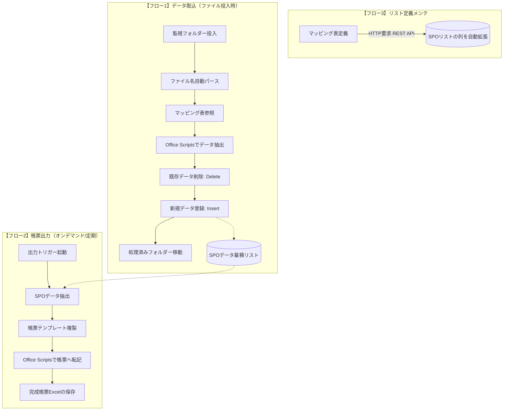

# 【システム基本設計・仕様書】Excel・SharePoint Online 連携データ転記・帳票生成システム

**版数**: 第 2.3 版（非テーブル・自由形式Excel完全対応版）  
**作成日**: 2026年10月10日  
**作成者**: トコ（Toko）＆ にゃー  

---

## 1. システム概要と基本思想

本システムは、各事業場等から投入される入力用Excelファイルを検知し、設定用マッピング表に従って**SharePoint Online（SPO）リスト**へデータを中間蓄積（データベース化）した後、指定された**出力用帳票Excel**へ柔軟に転記・生成する仕組みである。

### 設計基本思想
1. **設定駆動型（マッピング表駆動）**:
   新帳票の追加や項目・セル位置の変更時、プログラム（フローやスクリプト）のソースコードを改修せず、**マッピング表の行を追加・修正するだけ**で全転記が完結する構造とする。
2. **M365標準機能による完結（追加コストゼロ）**:
   Power Automate プレミアムライセンスを必要とせず、M365標準コネクタ（「SharePoint に HTTP 要求を送信」等）および Office Scripts のみで構築する。
3. **既存Excelの「テーブル化」不要（現場フォーマット完全無加工対応）**:
   通常のPower Automate標準アクションが抱える「Excelのテーブル化（Ctrl+T）必須」という強い制約を、**Office Scripts の直接レンジ操作（getRange/setValues）によって完全に排除**する。現場の既存申請書、罫線のみの非テーブル枠、結合セルを一切加工することなくそのまま取り込み・出力可能とする。
4. **3つの独立フローによる責務の分離**:
   取込、出力、メンテを1つのフローに詰め込まず、独立した3本のフローとして構築することで、高い堅牢性と保守性を実現する。
5. **安全重視のスキーマ拡張設計（追加のみ自動化・削除は非対象）**:
   SPOリストの列メンテナンスは「新規列の自動追加」のみを行い、既存データの消失事故を防ぐため「列の削除」は自動化しない。



---

## 2. システムを構成する「3つの独立フロー」定義

| フロー名 | トリガー | 役割・処理概要 | 主な実行アクション |
| :--- | :--- | :--- | :--- |
| **① データ取込フロー**<br>(Input Flow) | 監視フォルダーへのファイル作成 | 入力Excelを解析し、Delete & Insert方式でSPOリストへデータを格納する。 | ファイル名パース、マッピング取得、Office Scripts実行、複数項目削除、複数項目作成 |
| **② 帳票出力フロー**<br>(Output Flow) | オンデマンド（手動ボタン/締めスケジュール） | SPOリストからデータを抽出し、テンプレートExcelに流し込んで帳票を生成する。 | 複数項目取得、ファイル複製、Office Scripts実行、ファイル保存 |
| **③ スキーマ保守フロー**<br>(Schema Maintenance) | 手動実行（マッピング表修正時） | マッピング表の項目定義を読み取り、SPOリストに未作成の列を自動追加する。 | リスト項目取得、条件判定、SharePoint に HTTP 要求を送信 (POST) |

---

## 3. 入力ファイル命名規則と自動パース仕様

### 3.1 命名フォーマット（帳票による自動分岐）
監視フォルダーに投入される入力Excelファイルは、アンダースコア（`_`）区切りの命名規則に従う。

| 帳票種類 | 命名フォーマット | 具体例 | 要素数 |
| :--- | :--- | :--- | :---: |
| **D-2 帳票** | `{帳票コード}_{事業場コード}_{上期または下期}.xlsx` | `D-2_10010001_上期.xlsx` | 3要素 |
| **上記以外の帳票** | `{帳票コード}_{事業場コード}.xlsx` | `D-2-3_20050001.xlsx` | 2要素 |

### 3.2 パース（分割）および動的判定ロジック
Power Automateにて `split(replace(ファイル名, '.xlsx', ''), '_')` を実行し、動的にメタデータを割り当てる。

1. **第1要素 (`parts[0]`)**: **帳票コード (FormCode)**（マッピング検索キー）
2. **第2要素 (`parts[1]`)**: **事業場コード (PlantCode)**（レコード特定キー）
   * **データ仕様**: **システム内8桁統一・文字列型（テキスト型）必須**。
   * **重要制約**: 先頭が `0` のコード（例: `00012345`）の桁落ち（ゼロサプレス）を防止するため、Excel・スクリプト・フロー・SPOの全層で数値変換を禁止し、テキストとして扱う。
   * **バリデーション**: 8桁以外のファイルが投入された場合はエラー検知・スキップ処理を行う。
3. **第3要素 (`parts[2]`)**: **期区分 (PeriodKeyword)**
   * `FormCode == 'D-2'` の場合のみ取得（`上期` または `下期`）。
   * その他の帳票の場合は空欄（または「なし」）。

---

## 4. データ蓄積・洗い替え仕様（Delete & Insert 方式）

明細行の増減によるゴーストデータ（古い不要レコードの残留）を完全に防止するため、Upsertではなく**「対象キーに一致する既存レコードを全削除した上で、新規登録（Insert）する」** 方式を採用する。

### 4.1 削除抽出条件（OData フィルター）の自動分岐

* **D-2 帳票の場合**:
  `PlantCode eq '{事業場コード}' and FormCode eq 'D-2' and PeriodKeyword eq '{期区分}'`
  *(例: `PlantCode eq '10010001' and FormCode eq 'D-2' and PeriodKeyword eq '上期'`)*
* **その他の帳票の場合**:
  `PlantCode eq '{事業場コード}' and FormCode eq '{帳票コード}'`
  *(例: `PlantCode eq '20050001' and FormCode eq 'D-2-3'`)*

### 4.2 Delete & Insert のメリット
1. **明細減少時のゴミ残りゼロ**: 前回30行 ➔ 今回5行の場合でも、古い25行が残らず完全同期。
2. **処理の高速・安定化**: 1行ずつの存在チェック・分岐処理が不要。

---

## 5. 転記方式の定義（3パターン）

### 5.1 「テーブル化不要」を実現する技術的メカニズム
本システムでは、Power Automate標準のExcelコネクタ（テーブル必須）を使用せず、**Office Scripts の Range API（`getRange`, `getValues`, `setValues`）** を採用する。

* **現場Excelへの無加工適用**: 罫線のみで作成された枠、結合セル、複数行ヘッダーなど、Excel標準の「テーブル機能（Ctrl+T）」に変換できない自由形式のシートでも、そのまま読み書き可能。
* **書式・デザインの完全保護**: 帳票Excel側のフォント、罫線、色、印刷範囲設定に一切干渉せず、値のみをピンポイントで流し込む。

### 5.2 転記パターンの比較

| 転記方式 | 対象のイメージ | データ構造 | 行走査・判定ロジック |
| :--- | :--- | :--- | :--- |
| **方式1：個別セル散在型** | 申請書・単票・チェック票 | 1シート ＝ 1レコード | 指定セル（`B2`, `D5` 等）から値を抽出し、SPOリストの**1行**に集約。 |
| **方式2-A：明細・上詰め連続型** | 途切れのない明細・集計表 | 1表 ＝ 複数レコード | 開始行から下方走査し、**「最初の空行」を検知した時点で終了（Break）**。 |
| **方式2-B：明細・固定枠/歯抜け型** | 30行枠などの固定枠シート | 1表 ＝ 複数レコード | 最大枠行数（例: 30行）まで**必ず全行走査**。空行はスキップし、有効データのみ抽出。 |

---

## 6. マッピング表データモデル設計

マッピング表はSPOリストとして保持し、運用・確認用にExcelへのエクスポートも可能とする。
「入力（Input）」と「出力（Output）」のそれぞれについて、**ブック ➔ シート ➔ 行/列 ➔ セル** を漏れなく完全に対称管理する設計とする。

### 6.1 カラム定義（SPOリスト内部定義）

| 大分類 | 列名（内部名） | 表示名 | 型 | 必須 | 説明・設定例 |
| :--- | :--- | :--- | :---: | :---: | :--- |
| **基本識別** | **FormCode** | 帳票コード | 一行テキスト | ○ | ファイル名と一致する識別子（例: `D-2`, `D-2-3`） |
| | **MappingID** | マッピングID | 一行テキスト | ○ | 1つの転記ジョブを表すグループID（例: `MAP_D2`, `MAP_D23`） |
| | **TransferType** | 転記方式 | 選択肢 | ○ | `方式1:個別セル` / `方式2-A:連続明細` / `方式2-B:固定枠明細` |
| | **FieldName** | 項目名 | 一行テキスト | ○ | 人が見てわかる名前（例: `事業場コード`, `品名`, `点検結果`） |
| | **IsPrimaryKey** | 主キーフラグ | はい/いいえ | ○ | レコード特定・削除対象キーフラグ（事業場コード等） |
| **SPO定義** | **SPColumnName** | SPO内部列名 | 一行テキスト | ○ | データ格納先SPOリストの列名（※自動拡張対象） |
| | **DataType** | データ型 | 選択肢 | ○ | `Text`, `Number`, `DateTime`, `Choice` など |
| **入力元<br>(Input)** | **InputSheet** | 入力シート名 | 一行テキスト | ○ | 対象シート名（例: `点検様式`, `Sheet1`） |
| | **InputLocation** | 入力位置 | 一行テキスト | ○ | **セル番地（例: `B2`）** または **列記号（例: `B`）** |
| | **InputStartRow** | 入力開始行 | 数値 | - | 表形式（方式2）の読み取り開始行（例: `5`） |
| | **InputMaxRows** | 入力枠上限 | 数値 | - | 方式2-Bの固定枠数（例: `30`） |
| | **IsEmptyCheck** | 空行判定キー | はい/いいえ | - | この項目が空の場合に終了/スキップとするフラグ |
| **出力先<br>(Output)** | **OutputWorkbook** | 出力テンプレート名 | 一行テキスト | ○ | 転記先の雛形ファイル名（例: `Template_D2.xlsx`） |
| | **OutputSheet** | 出力シート名 | 一行テキスト | ○ | 転記先帳票のシート名（例: `報告帳票`） |
| | **OutputLocation** | 出力位置 | 一行テキスト | ○ | **セル番地（例: `D10`）** または **列記号（例: `C`）** |
| | **OutputStartRow** | 出力開始行 | 数値 | - | 表形式の書き込み開始行（例: `7`） |
| | **OutputMaxRows** | 出力枠上限 | 数値 | - | 帳票側の明細枠上限行数（例: `30`） |
| | **SortOrder** | 出力ソート順 | 一行テキスト | - | 出力時の並び替えルール（例: `1:ASC`） |

### 6.2 ブック・シート・セルの階層処理規則
1. **1つの転記ジョブに対して1つの `MappingID`**:
   同一の転記処理に属する全項目（事業場コード、品名、数量等）には同一の `MappingID` を付与し、グループとして一括処理する。
2. **ヘッダー共通セルと明細列の自動判別**:
   表形式（方式2）において、`InputLocation` の記述形式によりOffice Scriptsが自動判別する：
   * **セル番地（例: `B2`）**: シート上部の固定セルから取得し、**明細の全レコードに共通値として自動付与**（事業場コード等の共通ヘッダー）。
   * **列記号（例: `B`）**: 明細各行の該当列から1行ずつ個別に取得。
3. **複数シート対応**:
   同一ブック内の異なるシート（例: 表紙シートと明細シート）からの抽出・転記も、マッピング行ごとに `InputSheet` / `OutputSheet` を指定することで1つのジョブ内で完結可能。

---

## 7. SPOリスト自動拡張機能（フロー3の詳細）

マッピング表に新しい項目（列）が追加された際、SPOリストの設定を手作業で変更することなく、フローから自動で列を生成する。

### 7.1 安全設計原則（追加のみ自動化・削除は非対象）
* **追加（拡張）の自動化**:
  マッピング表の `SPColumnName` を走査し、SPOリスト側に存在しない列のみを新規追加する。
* **削除の非対象化（絶対安全ルール）**:
  マッピング表から項目が削除・非表示化された場合でも、**SPOリスト側の列を自動削除（Drop Column）することは絶対にしない**。
* **削除を行わない理由と効果**:
  1. **誤削除によるデータ全消滅の防止**: マッピング表の誤編集や一時的な除外設定によって、過去数年分蓄積された列データが永久喪失する大事故を100%防止する。
  2. **過去履歴・バックナンバーの保護**: 使われなくなった古い項目のデータもリスト上にそのまま安全に保管される。
  3. **システム動作への影響ゼロ**: 取込・出力フローは「現行のマッピング表にある列」のみを対象とするため、使われない列がリストに残っていても正常稼働に一切影響しない。
  4. **不要列の整理運用**: 完全に不要となった列を画面から除去したい場合のみ、管理者がSPOリスト設定画面から手動で削除する。

### 7.2 実装仕様
* **使用アクション**: `SharePoint に HTTP 要求を送信`（標準コネクタ / 無料）
* **エンドポイント**: `_api/web/lists/getByTitle('{データ蓄積リスト名}')/fields`
* **メソッド**: `POST`
* **リクエスト本文（例: テキスト列追加）**:
  ```json
  {
    "__metadata": { "type": "SP.Field" },
    "Title": "{SPColumnName}",
    "FieldTypeKind": 2
  }
  ```
  *(※ FieldTypeKind: 2=テキスト, 9=数値, 4=日時 等、DataTypeに応じて分岐)*

---

## 8. 今後の実装ステップ・検証項目

1. **ステップ1**: SPO上に「マッピング表リスト」および「データ蓄積リスト」の枠組み作成
2. **ステップ2**: 【フロー3】リスト拡張フローの実装・テスト（マッピング表から列が自動生成されるか確認）
3. **ステップ3**: 入力用 Office Scripts の作成（方式1, 方式2-A, 方式2-B のデータ抽出ロジック）
4. **ステップ4**: 【フロー1】データ取込フローの実装・テスト（ファイル名パース ➔ 削除 ➔ 登録）
5. **ステップ5**: 出力用 Office Scripts および 【フロー2】帳票出力フローの実装
